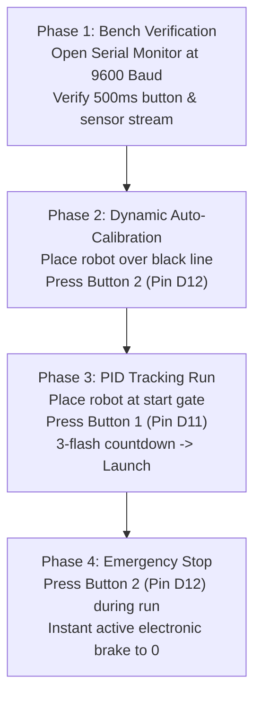

# Arduino Nano Firmware Upload & Operating Guide

> **Project**: Fast PID Line Follower Robot (Direct No-MUX Edition)  
> **Source Directory**: `Combined_Part1_to_Part8_NoMUX_Fixed`  
> **Target Controller**: Arduino Nano (ATmega328P, 16 MHz, 5V)  
> **Motor Driver**: Toshiba TB6612FNG Dual H-Bridge  
> **Sensor Array**: 8-Channel TCRT5000 IR Phototransistors (Direct Analog A0–A7)  

---

## 1. How Multi-File Arduino Sketches Work

> [!IMPORTANT]
> **You do NOT upload the files one by one or in a sequence.**  
> In Arduino, all `.ino` files located inside the same folder belong to **one single project**.

When you open [`Combined_Part1_to_Part8_NoMUX_Fixed.ino`](file:///C:/Users/kenne/Desktop/lfr/Combined_Part1_to_Part8_NoMUX_Fixed/Combined_Part1_to_Part8_NoMUX_Fixed.ino) in the Arduino IDE:
- Arduino IDE automatically loads **all 7 `.ino` files** in this folder as tabs across the top:
  1. `Combined_Part1_to_Part8_NoMUX_Fixed.ino` — Entry point (`setup()`, `loop()`, pin definitions, global variables)
  2. `read_sensor.ino` — Direct ADC sampling on pins A0–A7, digital binarization, centroid moment calculation
  3. `PID_Controller.ino` — Closed-loop proportional-derivative steering and 90° turn state arbitrator
  4. `Turns.ino` — Differential in-place spin pivots with 1500 ms safety watchdog
  5. `SensorCalibration.ino` — 4-sweep dynamic auto-calibration and EEPROM persistence
  6. `motor.ino` — TB6612FNG differential drive H-bridge control with signed speed clamping
  7. `distance.ino` — Open-loop distance dead-reckoning routines
- When you click the **Upload** button ($\rightarrow$), the compiler merges all tabs into a single binary (`.hex`) and flashes it onto the Arduino Nano in one single operation.

---

## 2. How to "Clear" Old Code on the Arduino Nano

Microcontrollers like the ATmega328P do not have an operating system, file manager, or folders:

1. **Flash Program Memory**:
   - Every time you click **Upload**, the programming tool (`avrdude`) automatically runs a **full Chip Erase**, completely erasing the previous sketch before flashing the new code.
   - You do **not** need to manually format, erase, or delete old files.
2. **EEPROM (Non-Volatile Calibration Memory)**:
   - The Nano contains 1,024 bytes of internal EEPROM used to store calibrated white/black sensor thresholds.
   - Whenever you run calibration via **Button 2**, the firmware automatically overwrites bytes `0` through `23` with the fresh calibration data using `EEPROM.update()`.

---

## 3. Step-by-Step Arduino IDE Upload Instructions

### Step 3.1: Open the Project
1. Launch **Arduino IDE**.
2. Click **File $\rightarrow$ Open...**
3. Navigate to:
   ```
   C:\Users\kenne\Desktop\lfr\Combined_Part1_to_Part8_NoMUX_Fixed\Combined_Part1_to_Part8_NoMUX_Fixed.ino
   ```
4. Verify that all 7 `.ino` files appear as tabs along the top bar.

### Step 3.2: Connect Your Nano & Select the Port
1. Connect the Arduino Nano to your computer using a USB cable.
2. In Arduino IDE, go to **Tools $\rightarrow$ Board $\rightarrow$ Arduino AVR Boards $\rightarrow$ Arduino Nano**.
3. Go to **Tools $\rightarrow$ Port** and select the COM port assigned to your Nano (e.g., `COM3`, `COM4`, `COM9`, etc.).

### Step 3.3: Select Processor & Upload (Old vs New Bootloader)
Most Nano boards and clones (using CH340 or CP2102 USB chips) use the **Old Bootloader**:

1. Click **Tools $\rightarrow$ Processor** and select **"ATmega328P (Old Bootloader)"**.
2. Click the **Upload** button (the right arrow $\rightarrow$ icon in the top toolbar).
3. Wait for the compilation and upload to finish:
   - **Success**: The bottom output window displays `Done uploading`, and:
     ```
     Sketch uses 10592 bytes (34%) of program storage space.
     Global variables use 384 bytes (18%) of dynamic memory.
     ```
   - **If you get an error** (`avrdude: stk500_recv(): programmer is not responding`):
     - Go back to **Tools $\rightarrow$ Processor**.
     - Switch the option to **"ATmega328P"** (New Bootloader).
     - Click **Upload** again.

---

## 4. Alternative: One-Click CLI Upload (Optional)

If you prefer uploading directly from PowerShell or Terminal without opening the Arduino IDE GUI, run:

```powershell
# For Nano with Old Bootloader (replace COM9 with your actual COM port):
& "C:\Users\kenne\AppData\Local\Programs\Arduino IDE\resources\app\lib\backend\resources\arduino-cli.exe" upload -p COM9 --fqbn arduino:avr:nano:cpu=atmega328old "C:\Users\kenne\Desktop\lfr\Combined_Part1_to_Part8_NoMUX_Fixed"

# For Nano with New Bootloader:
& "C:\Users\kenne\AppData\Local\Programs\Arduino IDE\resources\app\lib\backend\resources\arduino-cli.exe" upload -p COM9 --fqbn arduino:avr:nano "C:\Users\kenne\Desktop\lfr\Combined_Part1_to_Part8_NoMUX_Fixed"
```

---

## 5. Chronological Operating Sequence (Bench Test $\rightarrow$ Calibration $\rightarrow$ Run)



### Phase 1: Bench Diagnostics & Serial Telemetry Check
1. Keep the Arduino Nano plugged into USB.
2. Open **Tools $\rightarrow$ Serial Monitor** and set the baud rate to **9600 Baud**.
3. You should see the startup banner followed by a live status update every 500 ms:
   ```text
   ========================================================
      FAST PID LINE FOLLOWER ROBOT (DIRECT NO-MUX EDITION) 
              REVISED & ENHANCED PRODUCTION FIRMWARE        
   ========================================================

   [IDLE MONITOR] Btn1(D11): HIGH(1)     | Btn2(D12): HIGH(1)     | Bitmask: 00011000 | Active: 2 | Centroid Pos: 45.0 | (Press D11 to Run)
   ```
4. **Verify Button 1 (Start)**:
   - Press Button 1. The output must change from `Btn1(D11): HIGH(1)` to `Btn1(D11): PRESSED(0)`.
5. **Verify Button 2 (Calib / Halt)**:
   - Press Button 2. The output must change from `Btn2(D12): HIGH(1)` to `Btn2(D12): PRESSED(0)`.
6. **Verify Sensors**:
   - Slide a white surface beneath all 8 sensors: `Bitmask` reads `00000000`, `Active: 0`.
   - Slide a strip of black electrical tape under center sensors S3 & S4: `Bitmask` reads `00011000`, `Active: 2`, and `Centroid Pos: 45.0`.

---

### Phase 2: Dynamic Auto-Calibration (Button 2)
1. Disconnect the USB cable (or turn on battery power).
2. Place the robot on your competition track surface with the black line centered under the sensor array.
3. Press **Button 2 (Pin D12)**.
4. The robot will execute an autonomous **4-sweep rotational scan** (left, right, right, left):
   - Measures maximum black reflectance and minimum white background reflectance for all 8 sensors.
   - Calculates the dynamic midpoint threshold: $\text{Threshold}_i = \frac{\text{Max}_i + \text{Min}_i}{2}$.
   - Automatically saves these thresholds to non-volatile EEPROM.

---

### Phase 3: High-Speed Closed-Loop PID Line Following (Button 1)
1. Place the robot at the starting line of the track.
2. Press **Button 1 (Pin D11)**.
3. The onboard LED will flash **3 rapid times** (1-second safety countdown) allowing you to take your hands off the robot safely.
4. The robot will launch into closed-loop PD line tracking at `base_speed = 200`.

---

### Phase 4: Emergency Stop / User Halt (Button 2)
- At any time while the robot is running on the track, press **Button 2 (Pin D12)**.
- Motors immediately engage **active electronic braking** (`motor(0, 0)`), the status LED turns off, and the firmware cleanly returns to the idle monitoring loop.

---

## 6. Master Hardware Pin Connection Table

| Subsystem Component | Arduino Nano Pin | Destination Module Pin | Direction / Type | Critical Operating Notes |
| :--- | :--- | :--- | :--- | :--- |
| **Sensor 0 (Far Left)** | `A0` | TCRT5000 `OUT 0` | Analog ADC In | Weight = 10, Bit 7 |
| **Sensor 1** | `A1` | TCRT5000 `OUT 1` | Analog ADC In | Weight = 20, Bit 6 |
| **Sensor 2** | `A2` | TCRT5000 `OUT 2` | Analog ADC In | Weight = 30, Bit 5 |
| **Sensor 3 (Center Left)**| `A3` | TCRT5000 `OUT 3` | Analog ADC In | Weight = 40, Bit 4 |
| **Sensor 4 (Center Right)**| `A4`| TCRT5000 `OUT 4` | Analog ADC In | Weight = 50, Bit 3 |
| **Sensor 5** | `A5` | TCRT5000 `OUT 5` | Analog ADC In | Weight = 60, Bit 2 |
| **Sensor 6** | `A6` | TCRT5000 `OUT 6` | Analog ADC In | Weight = 70, Bit 1 (Analog-only pin) |
| **Sensor 7 (Far Right)** | `A7` | TCRT5000 `OUT 7` | Analog ADC In | Weight = 80, Bit 0 (Analog-only pin) |
| **Left Motor PWM** | `D5` | TB6612FNG `PWMB` | Digital PWM Out | Timer 0 Hardware PWM |
| **Left Motor IN3** | `D2` | TB6612FNG `BIN1` | Digital Out | Direction line 1 (HIGH = Forward) |
| **Left Motor IN4** | `D4` | TB6612FNG `BIN2` | Digital Out | Direction line 2 (HIGH = Reverse) |
| **Right Motor PWM** | `D6` | TB6612FNG `PWMA` | Digital PWM Out | Timer 0 Hardware PWM |
| **Right Motor IN1** | `D7` | TB6612FNG `AIN1` | Digital Out | Direction line 1 (HIGH = Forward) |
| **Right Motor IN2** | `D8` | TB6612FNG `AIN2` | Digital Out | Direction line 2 (HIGH = Reverse) |
| **Motor Driver STBY** | `5V Rail` | TB6612FNG `STBY` | Power Input | **MUST be tied to 5V (Never leave floating!)** |
| **Motor High Voltage**| `Battery (+)` | TB6612FNG `VM` | Power Input | 7.4V to 11.1V high-current motor bus |
| **Driver Logic VCC** | `5V Rail` | TB6612FNG `VCC` | Power Input | 5.0V regulated logic supply |
| **Button 1 (Start PID)**| `D11` | Switch Leg 1 $\rightarrow$ `GND` | Digital In | Active-LOW (`INPUT_PULLUP`). Leg 2 to GND |
| **Button 2 (Calib/Stop)**| `D12` | Switch Leg 1 $\rightarrow$ `GND` | Digital In | Active-LOW (`INPUT_PULLUP`). Leg 2 to GND |
| **Status / Turn LED** | `D13` | Onboard LED | Digital Out | Flashes on countdown, turns & calibration |
| **Common Ground** | `GND` | All Subsystems | Common GND | Tie Nano GND, Driver GND, Battery (-), Buck GND |

---

## 7. Troubleshooting Quick Reference

| Problem | Probable Cause | Immediate Solution |
| :--- | :--- | :--- |
| **`programmer is not responding`** | Wrong processor selected in IDE | Change **Tools $\rightarrow$ Processor** from *ATmega328P* to *ATmega328P (Old Bootloader)* (or vice versa). |
| **Motors do not spin at all** | TB6612FNG `STBY` pin disconnected | Wire `STBY` directly to the `5V` regulated rail. |
| **Motors do not spin at all** | Motor power (`VM`) absent | Ensure LiPo battery is charged, connected to `VM`, and power switch is ON. USB alone cannot power DC motors. |
| **Robot spins in infinite circles** | Inverted motor wiring | Swap motor output wires on the reversing channel (swap `A01`/`A02` or `B01`/`B02`). |
| **Robot turns opposite to line** | Sensor array reversed | Confirm `A0` is mounted on the **Far Left** and `A7` on the **Far Right**. |
| **Buttons do not trigger** | Wired to 5V instead of GND | Re-wire switches between pin (`D11` or `D12`) and **GND**. Firmware uses internal pull-ups (`INPUT_PULLUP`). |
| **Sensors read all 0 or all 1** | Ground clearance improper | Adjust mounting brackets so TCRT5000 lenses are **3 mm to 5 mm** above the surface, then re-run calibration (Button 2). |
